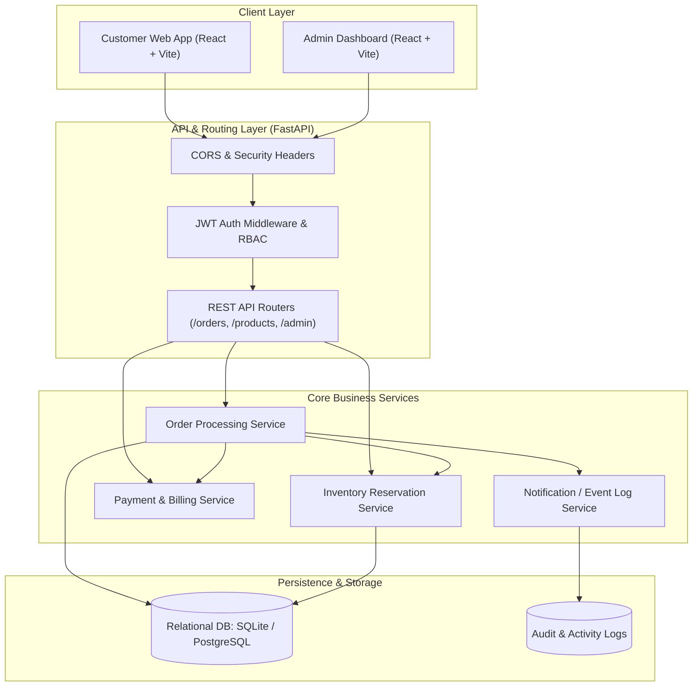
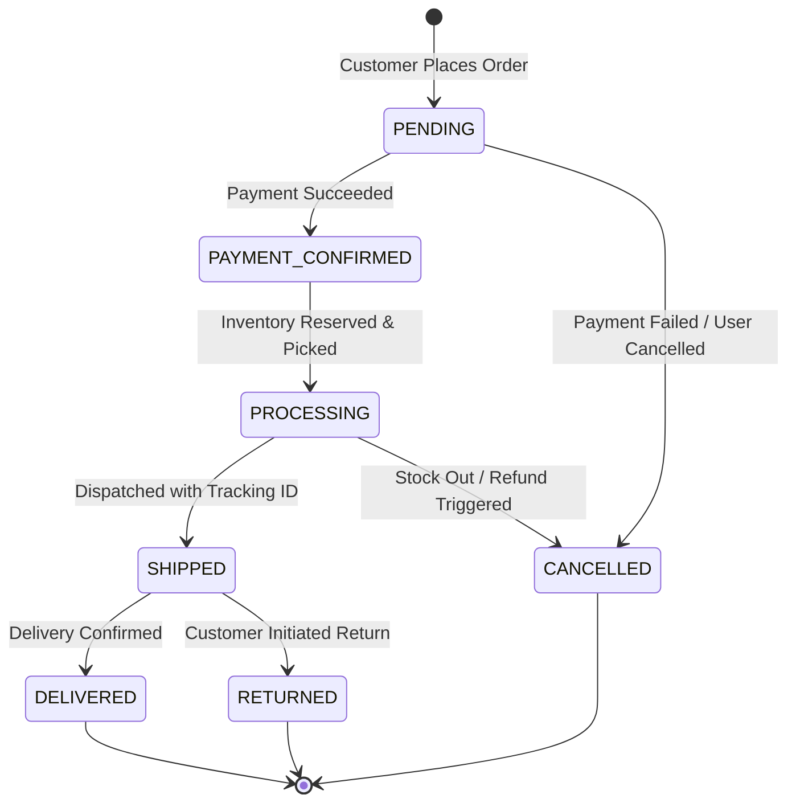
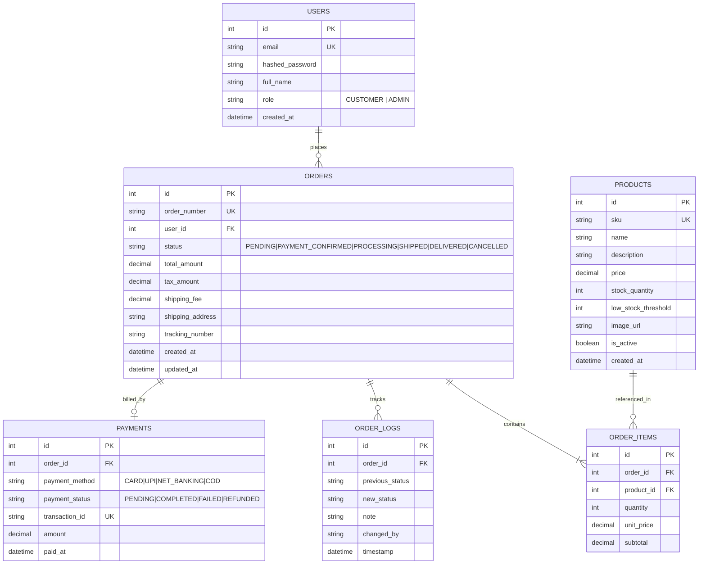
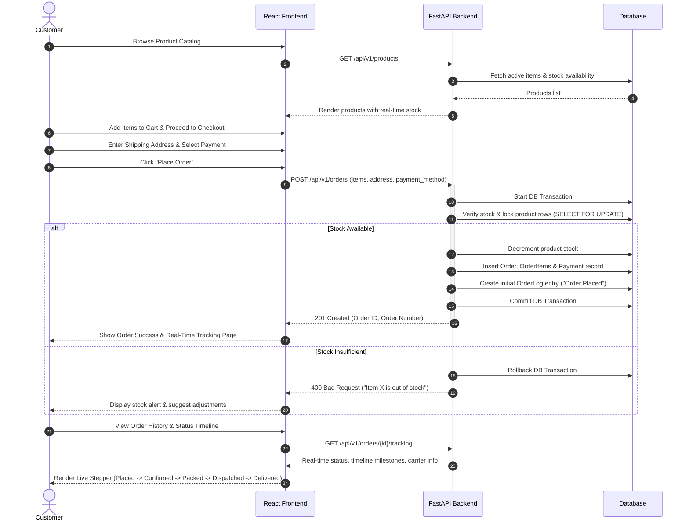
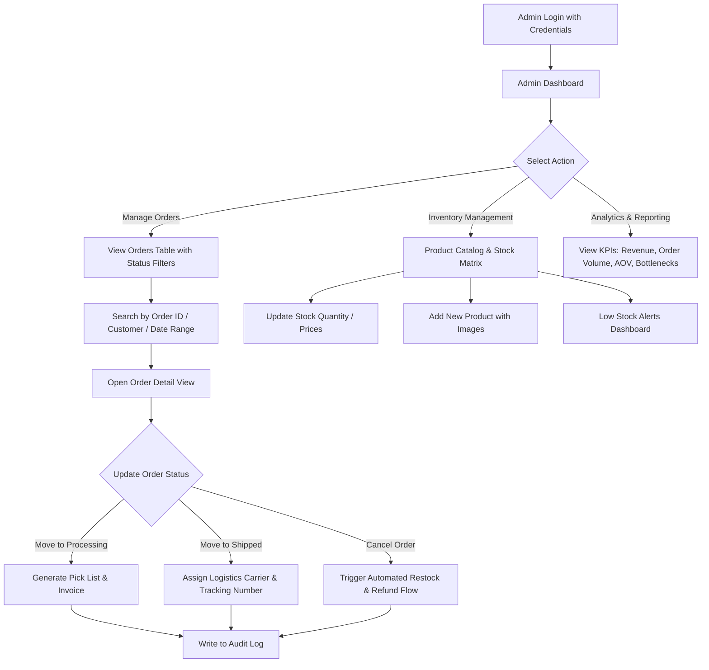

# Order Processing System - Product Requirement Document (PRD)

---

## 1. Executive Summary & Vision

The **Order Processing System** is an end-to-end e-commerce order fulfillment platform engineered to handle real-time order lifecycle tracking, inventory reservation, payment verification, and fulfillment dispatch. 

### Core Objectives
- **Reliability & Data Consistency:** Prevent overselling through atomic inventory locks and ACID transactions.
- **Real-Time Visibility:** Transparent status updates for customers and actionable dispatch workflows for administrators.
- **Modular Monolith Architecture:** Decoupled `backend` and `frontend` enabling independent scaling and seamless maintenance.

---

## 2. Technology Stack

| Layer | Technology | Rationale |
| :--- | :--- | :--- |
| **Backend API** | **Python (FastAPI)** | Async performance, auto-generated OpenAPI/Swagger documentation, strict typing with Pydantic v2. |
| **Database & ORM** | **SQLite (Dev) / PostgreSQL (Prod) + SQLAlchemy 2.0** | Robust relational support, migrations with Alembic, transactions with row-level locking. |
| **Data Validation** | **Pydantic v2** | High-performance data serialization, schema validation, and error formatting. |
| **Frontend Web App** | **React (Vite) + JavaScript/TypeScript** | Ultra-fast HMR build tool, dynamic component ecosystem, responsive state management. |
| **Styling & UI** | **Vanilla Modern CSS / CSS Modules** | Zero-bloat custom design system, glassmorphism accents, responsive layouts, micro-animations. |
| **Icons & Typography** | **Lucide Icons + Inter / Plus Jakarta Sans** | Modern aesthetic, crisp scalable icons, and clean typography. |
| **Authentication** | **JWT (JSON Web Tokens) with Argon2/Bcrypt** | Stateless session management with Role-Based Access Control (RBAC: `Customer`, `Admin`). |

---

## 3. System Architecture



---

## 4. Order Lifecycle State Machine

An order follows a deterministic state transition pipeline. Disallowed transitions are blocked with `400 Bad Request`.



### Transition Matrix & Invariants

| From State | Allowed Target State | Trigger / Actor | Automated Side Effects |
| :--- | :--- | :--- | :--- |
| `PENDING` | `PAYMENT_CONFIRMED` | System / Webhook | Deducts stock allocations into committed reservation. |
| `PENDING` | `CANCELLED` | Customer / Timeout | Releases soft stock lock. |
| `PAYMENT_CONFIRMED` | `PROCESSING` | Admin / Warehouse | Order packaged, packing slip generated. |
| `PROCESSING` | `SHIPPED` | Admin / Logistics | Tracking code attached, logistics partner notified. |
| `PROCESSING` | `CANCELLED` | Admin | Initiates payment refund & restores inventory. |
| `SHIPPED` | `DELIVERED` | Courier Webhook / Admin | Finalizes sale, updates analytics. |
| `SHIPPED` | `RETURNED` | Customer Support | Restores restockable goods into warehouse inventory. |

---

## 5. Database Schema & Data Models (ERD)



---

## 6. End-to-End User Flow (Customer Journey)



---

## 7. End-to-End Admin & Operations Flow



---

## 8. API Specification & Endpoints

All endpoints are prefixed with `/api/v1` and return standard JSON responses.

### 8.1 Authentication & Profile
- `POST /api/v1/auth/register` — Register customer account
- `POST /api/v1/auth/login` — Authenticate and return JWT access token
- `GET /api/v1/auth/me` — Retrieve current authenticated user profile

### 8.2 Products & Inventory
- `GET /api/v1/products` — List active products (supports `search`, `category`, `in_stock` filters)
- `GET /api/v1/products/{id}` — Get single product details
- `POST /api/v1/products` *(Admin)* — Create new product
- `PUT /api/v1/products/{id}` *(Admin)* — Update product details or stock
- `DELETE /api/v1/products/{id}` *(Admin)* — Soft-delete / deactivate product

### 8.3 Order Management (Customer)
- `POST /api/v1/orders` — Create new order with inventory check
  - **Payload**:
    ```json
    {
      "items": [
        { "product_id": 1, "quantity": 2 },
        { "product_id": 4, "quantity": 1 }
      ],
      "shipping_address": "221B Baker St, London, NW1 6XE",
      "payment_method": "CARD"
    }
    ```
- `GET /api/v1/orders` — List orders of logged-in customer (paginated)
- `GET /api/v1/orders/{order_number}` — Get specific order details & timeline
- `POST /api/v1/orders/{order_number}/cancel` — Cancel order (if still `PENDING` or `PAYMENT_CONFIRMED`)

### 8.4 Order Operations (Admin)
- `GET /api/v1/admin/orders` — List all orders across all customers with filter by status
- `PATCH /api/v1/admin/orders/{order_number}/status` — Transition order status
  - **Payload**:
    ```json
    {
      "status": "SHIPPED",
      "tracking_number": "TRK-98234812",
      "carrier": "FedEx Express",
      "note": "Package handed over to courier hub"
    }
    ```
- `GET /api/v1/admin/analytics/summary` — Key metrics (Total Revenue, Active Orders, Low Stock Alerts)

---

## 9. Critical Business Logic & Edge Cases

### 9.1 Concurrency & Overselling Prevention
- **Race Condition Handling:** When multiple customers order the last remaining units simultaneously, the database transaction enforces strict atomic decrement (`WHERE stock >= requested_quantity`).
- **Database Locks:** Uses `SELECT ... FOR UPDATE` (in PostgreSQL) or serialized isolation (in SQLite) to guarantee consistency.

### 9.2 Order Cancellation & Restocking
- When an order is cancelled prior to dispatch, the reserved units are automatically returned to the `stock_quantity` within the same transaction.
- An audit record is logged in `ORDER_LOGS` with the timestamp and author of cancellation.

### 9.3 Idempotency
- Order placement endpoints validate an `Idempotency-Key` header or deduplicate submissions within a 60-second window to prevent duplicate charges if a user double-clicks the "Place Order" button.

---

## 10. Project Directory Structure

```text
Order_Processing/
├── README.md                      # Complete PRD & Documentation
├── backend/                       # Python FastAPI Backend
│   ├── app/
│   │   ├── api/
│   │   │   ├── v1/
│   │   │   │   ├── endpoints/
│   │   │   │   │   ├── auth.py
│   │   │   │   │   ├── products.py
│   │   │   │   │   ├── orders.py
│   │   │   │   │   └── admin.py
│   │   │   │   └── api.py
│   │   ├── core/
│   │   │   ├── config.py          # App settings & env vars
│   │   │   ├── database.py        # SQLAlchemy engine & session maker
│   │   │   └── security.py        # Password hashing & JWT logic
│   │   ├── models/                # SQLAlchemy ORM Models
│   │   │   ├── user.py
│   │   │   ├── product.py
│   │   │   ├── order.py
│   │   │   └── payment.py
│   │   ├── schemas/               # Pydantic Schemas / DTOs
│   │   │   ├── user.py
│   │   │   ├── product.py
│   │   │   └── order.py
│   │   ├── services/              # Business logic services
│   │   │   ├── order_service.py
│   │   │   └── inventory_service.py
│   │   └── main.py                # FastAPI Application Entrypoint
│   ├── requirements.txt           # Python dependencies
│   └── seed_data.py               # Initial mock catalog & admin user
│
├── frontend/                      # React (Vite) Single Page Application
│   ├── public/
│   ├── src/
│   │   ├── assets/
│   │   ├── components/            # Reusable UI components
│   │   │   ├── Navbar.jsx
│   │   │   ├── OrderCard.jsx
│   │   │   ├── StatusBadge.jsx
│   │   │   ├── TimelineStepper.jsx
│   │   │   └── Modal.jsx
│   │   ├── context/               # Auth & Cart Context Providers
│   │   │   ├── AuthContext.jsx
│   │   │   └── CartContext.jsx
│   │   ├── pages/                 # Route Pages
│   │   │   ├── CatalogPage.jsx
│   │   │   ├── CartCheckoutPage.jsx
│   │   │   ├── OrderDetailPage.jsx
│   │   │   ├── OrderHistoryPage.jsx
│   │   │   ├── AdminDashboardPage.jsx
│   │   │   └── AdminInventoryPage.jsx
│   │   ├── services/              # API Client (Axios / Fetch)
│   │   │   └── api.js
│   │   ├── index.css              # Global styles & design tokens
│   │   ├── App.jsx                # Router & App layout
│   │   └── main.jsx
│   ├── index.html
│   ├── package.json
│   └── vite.config.js
```

---

## 11. Development Roadmap & Milestones

- [x] **Phase 1: PRD & Architecture Specification** (Complete in `README.md`)
- [ ] **Phase 2: Backend Core & DB Engine**
  - Database schema models & migrations
  - JWT Auth & role guard middleware
  - Product catalog CRUD & inventory reservation logic
  - Order state machine & transactional checkout endpoint
  - Seed script with sample products & test accounts
- [ ] **Phase 3: Frontend Client Experience**
  - Modern design system & responsive layout (Dark/Light mode accents)
  - Product catalog with live search, filtering, and cart drawer
  - Checkout flow with address input & simulated payment
  - Real-time order tracking timeline
- [ ] **Phase 4: Admin Operations Center**
  - Orders kanban/table with quick status transitions (`Processing` -> `Shipped` -> `Delivered`)
  - Inventory management modal with stock level increment/decrement
  - Audit log viewer for order lifecycle events
- [ ] **Phase 5: Automated Testing & Validation**
  - Pytest suite for concurrency & stock edge cases
  - Frontend end-to-end user checkout & admin dispatch verification
